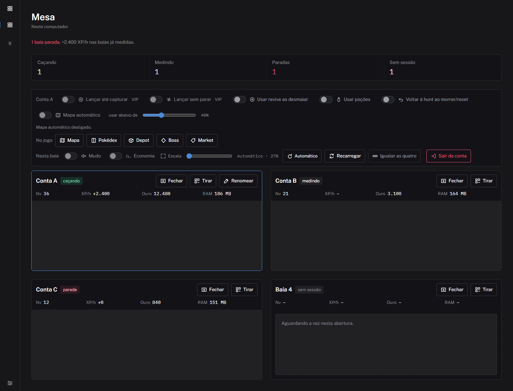
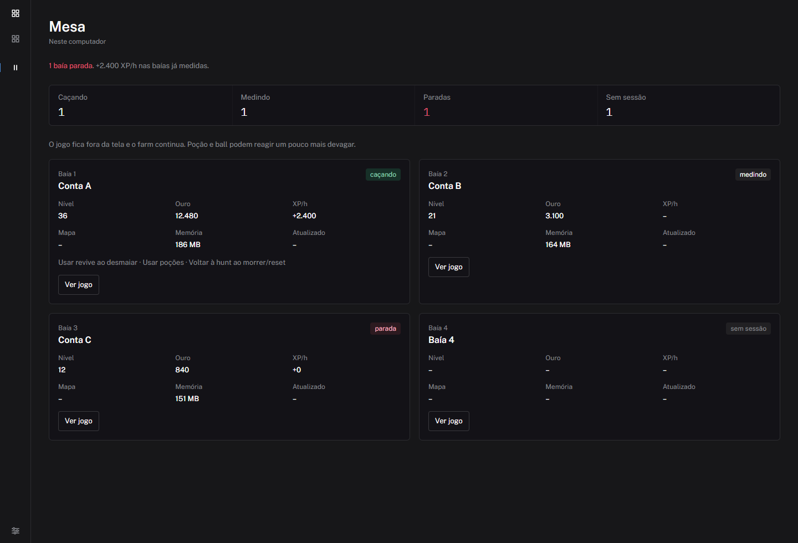
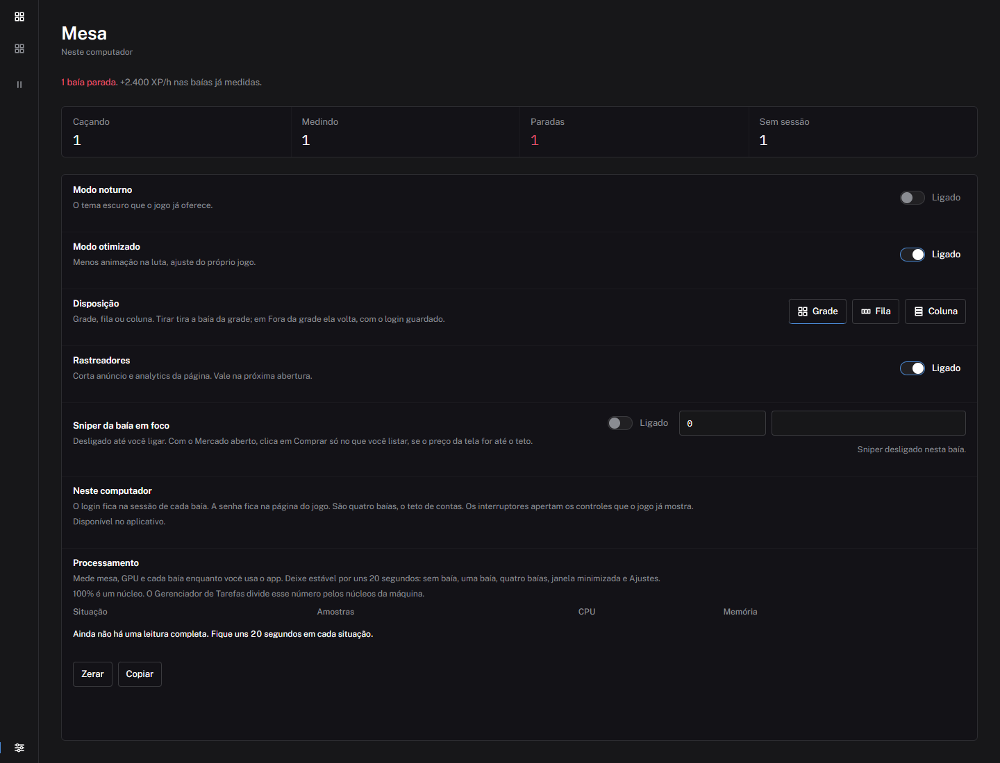

# Mesa

Mesa é o aplicativo de Windows para jogar [pokeidle.io](https://pokeidle.io/app) em até quatro contas ao mesmo tempo, neste computador. Cada conta fica numa baía, com a sessão guardada localmente. A senha continua na página do jogo.

[Baixar Mesa.exe](https://github.com/pdrfps1/mesa-pokeidle/releases/latest/download/Mesa.exe) · versão 0.3.0 · Windows

O Windows pode pedir confirmação na primeira abertura: o executável é portátil e não leva instalador.

As imagens abaixo usam contas de exemplo (Conta A, B e C) para mostrar os estados da mesa. No aplicativo, o jogo abre dentro de cada baía.

## Mesa

A tela principal mostra as quatro baías e o resumo: caçando, medindo, paradas e sem sessão. A baía em foco tem a borda azul. Os interruptores dessa baía apertam os controles que o jogo já mostra.



- **Caçando** — a conta está ganhando XP.
- **Medindo** — a sessão existe e a Mesa ainda está calculando o XP/h.
- **Parada** — a sessão existe e o XP/h chegou a zero.
- **Sem sessão** — a baía ainda não tem login.

Na baía em foco dá para mudar o mapa, a Pokédex, o depot, o boss e o mercado, recarregar a página, igualar as quatro contas e sair daquela conta. Sair pede confirmação e apaga só a sessão daquela baía. **Fechar** esconde o jogo e guarda o login. **Tirar** tira a baía da grade e para o jogo dessa conta. Em Ajustes, **Fora da grade** devolve a baía, com o login guardado.

**Lançar até capturar** e **Lançar sem parar** são VIP e se excluem. **Usar revive ao desmaiar**, **Usar poções** e **Voltar à hunt ao morrer/reset** valem para a baía em foco. A poção só entra abaixo da porcentagem escolhida. Voltar à hunt só acontece enquanto houver poção ou revive na bolsa.

**Mapa automático** troca o mapa dessa conta quando outra hunt rende mais XP de treinador. O interruptor começa desligado. Com ele ligado, a Mesa lê o guia de hunts, espera o combate liberar e usa o comando do jogo. A troca só acontece se a outra hunt render pelo menos cerca de 8% a mais do que o mapa atual.

## Espera

Em Espera o jogo sai da tela e a conta continua. Poção e ball podem reagir um pouco mais devagar. Cada carta mostra nível, ouro, XP/h, mapa, memória e o que está ligado. **Ver jogo** volta para a Mesa naquela baía. Fechar e tirar a baía ficam na tela Mesa.



## Ajustes



- **Modo noturno** e **Modo otimizado** usam opções que o jogo já oferece. O modo otimizado reduz animação na luta.
- **Disposição** alterna grade, fila ou coluna.
- **Rastreadores** corta anúncio e analytics da página. Passa a valer na próxima abertura.
- **Sniper da baía em foco** começa desligado. Com o mercado aberto, clica em Comprar só nos nomes listados, separados por vírgula, quando o preço da tela está até o teto.
- **Processamento** mede mesa, GPU e cada baía. A tabela enche depois de uns 20 segundos estáveis em cada situação: sem baía, uma baía, quatro baías, janela minimizada e Ajustes. O tempo passado em Espera entra na mesma leitura de Ajustes.

## Neste computador

São quatro baías, o teto de contas. Mudo, economia e a escala valem para a baía em foco. A escala volta para o tamanho automático pelo botão ao lado do controle.

Para instalar a partir deste repositório, no Windows, dê dois cliques em `instalar.cmd`. Ele instala o Node.js LTS se faltar, baixa as dependências e abre a Mesa.

Pelo terminal, na pasta do repositório:

```powershell
powershell -NoProfile -ExecutionPolicy Bypass -File .\instalar.ps1
```

`npm run dist` gera o `Mesa.exe` portátil.

## Licença

MIT. Mesa não é o site pokeidle.io e não é afiliada a ele.
