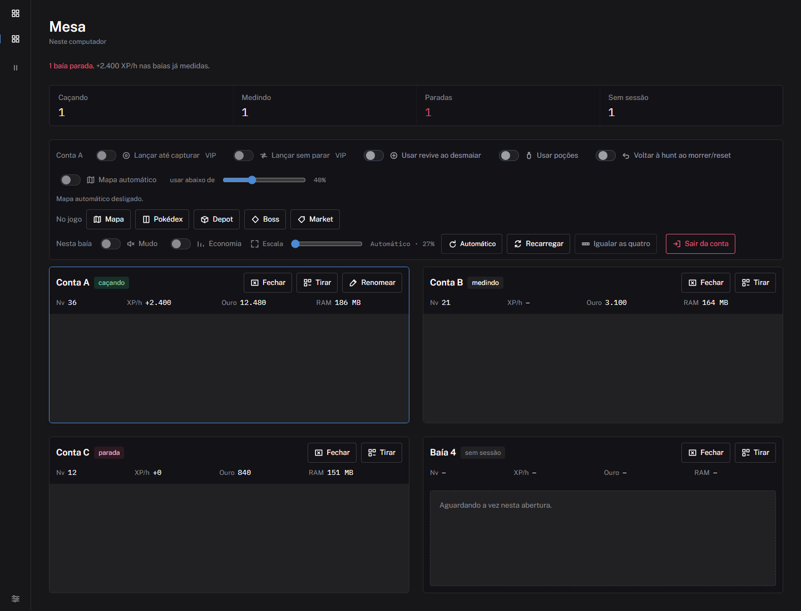
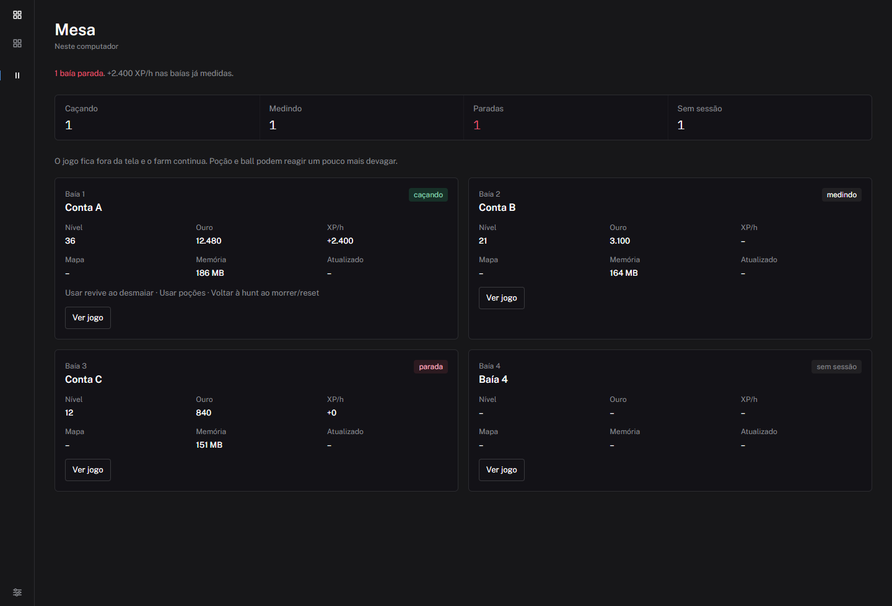
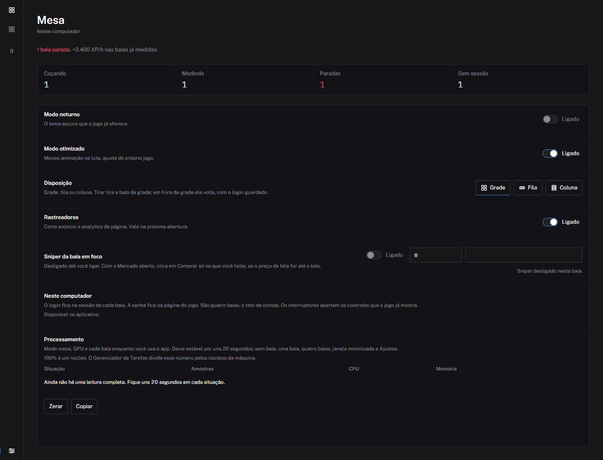

<div align="center">

# 🎮 PokeIdle Automation

**Quatro contas do PokeIdle na mesma janela, com a sessão guardada neste computador.**

<a href="https://github.com/pdrfps1/mesa-pokeidle/releases/latest"></a>
<a href="https://github.com/pdrfps1/mesa-pokeidle/releases/latest"></a>




As imagens deste README usam contas de exemplo (Conta A, B e C) e podem não mostrar a interface atual.

[Baixar](#%EF%B8%8F-como-baixar-e-instalar) · [Primeiro uso](#-primeiro-uso) · [Bônus da Twitch](#-bônus-da-twitch) · [Dúvidas](#-dúvidas-frequentes) · [Bugs e ideias](#-bugs-e-ideias)

</div>

---

## ✨ O que ele faz

| | |
| --- | --- |
| 🖥️ **Quatro baías** | Cada conta joga numa baía dentro da mesma janela. O limite é de quatro contas. |
| 💾 **Sessão local** | O login fica guardado neste computador. A senha continua só na página do jogo. |
| 📊 **Estados à vista** | Caçando, medindo, parada ou sem sessão, com o resumo no topo da tela **Automações**. |
| 🤖 **Automações por conta** | Mapa automático, revive, poções e voltar à hunt para a baía em foco. Lançar até capturar e Lançar sem parar são as automações VIP, e uma exclui a outra. |
| 🌙 **Espera** | Tira o jogo da tela e deixa a conta rodando, com uma carta de resumo por conta. |
| 💜 **Bônus da Twitch** | Resgata os bônus de XP, captura e shiny com os pontos das lives oficiais, depois que o prazo do bônus acaba. |
| 🟢 **Kick ao vivo** | Lista as lives da Kick que estão no ar, com o número de espectadores, e um botão **Abrir** para a live escolhida. |
| 🧮 **Calculadora de status** | Widget da Espera que busca o Pokémon na PokeAPI e calcula stats e recarga com as fórmulas do projeto. Fica oculta até você ligá-la pelo menu Widgets. |
| 🎯 **Sniper** | Na baía em foco, clica em Comprar só nos nomes que você listar, quando o preço está até o teto. Desligado por padrão. |
| 🛡️ **Rastreadores** | Corta anúncio e analytics da página. Vale na próxima abertura. |

---

## 🪶 Feito para rodar 4 contas

O app tem controles para dividir o trabalho do computador entre as baías. Os números de consumo dependem da máquina, então o app não traz valores fixos. A tabela de Configurações mede o seu computador.

- **Espera:** o jogo sai da tela e a conta continua. Poção e ball podem reagir um pouco mais devagar.
- **Economia** (por baía): liga o modo economia do próprio jogo na baía em foco.
- **Mudo** (por baía): corta o som da baía em foco.
- **Ultra** (por baía): esconde o jogo e deixa só os números da sessão.
- **Disposição e escala:** a grade pode ser grade, fila, coluna ou livre. A escala da baía em foco volta ao automático pelo botão ao lado do controle.
- **Processamento:** em Configurações, a tabela **Processamento e Hardware** mede a mesa, a GPU e cada baía. Ela enche depois de uns 20 segundos estáveis em cada situação: sem baía, uma baía, quatro baías, janela minimizada e Configurações.

---

## ⬇️ Como baixar e instalar

1. Entre na página de [releases](https://github.com/pdrfps1/mesa-pokeidle/releases/latest) e baixe o arquivo da versão mais recente.
2. Abra o arquivo. A versão atualmente publicada, 0.3.2, é o `Mesa.exe`, um portátil sem instalação. Link direto: [Mesa.exe](https://github.com/pdrfps1/mesa-pokeidle/releases/latest/download/Mesa.exe).
3. A partir da release 0.4.0, que ainda não foi publicada, o app passa a se chamar **PokeIdle Automation** e você também pode usar o instalador.

> [!NOTE]
> O Windows pode avisar que o app não é de um editor conhecido. Isso acontece porque o build não é assinado, ou seja, não tem certificado. Confirme que o arquivo veio da página de releases deste repositório antes de abrir.

**O que vem na release** (a partir da 0.4.0):

| Arquivo | Para quem é |
| --- | --- |
| `PokeIdle-Automation-Setup.exe` | Instalador. Instala por usuário, sem pedir administrador, com escolha de pasta, atalhos e desinstalador. |
| `PokeIdle-Automation.exe` | Portátil, sem instalação. |
| `Mesa.exe` | Alias do portátil, com os mesmos bytes. Serve para quem tem a versão 0.3.2 ou anterior, que só procura esse nome na release. |

> [!WARNING]
> Não abra o portátil e o instalado ao mesmo tempo. Os dois usam a mesma pasta de dados, `%APPDATA%\Mesa`.

**Requisitos**

- Windows 10 ou 11.
- Conexão com a internet, para o jogo e para a Twitch.
- Para compilar a partir do código: Node.js LTS. Veja a seção «Compilar a partir do código», no fim deste documento.

---

## 🚀 Primeiro uso

1. Abra o app. A tela **Automações** (a Mesa) mostra as quatro baías.
2. Escolha uma baía e clique em **Abrir**. O jogo carrega dentro dela.
3. Na aba **Conta**, clique em **Entrar com Google**. Entre no jogo na janela do navegador que abrir, feche essa janela e volte ao app. Se a conta não entrar sozinha, clique em **Já entrei**.
4. Repita para as outras baías que quiser usar. Cada baía tem a própria conta.
5. Depois, ajuste a disposição e as automações pela tela Automações ou em Configurações.

---

## 💜 Bônus da Twitch

- Cada baía assiste de 1 a 4 lives oficiais da Twitch. O padrão são 4. As lives rodam em janelas ocultas, sem som.
- Os pontos vêm de assistir à live do canal, não do chat. Eles são por canal e não somam entre lives.
- Para cada baía, entre na Twitch dentro da janela de login que o app abre para ela. Depois clique em **Já entrei**. O login do navegador de sempre não conta.
- Se o app não conseguir ler o login, a baía mostra o motivo. Veja as dúvidas abaixo.
- Só um resgate roda por vez no app inteiro, com 20 segundos entre um e outro, mesmo entre contas diferentes.
- Cada tipo de bônus (XP, captura e shiny) é resgatado quando o prazo dele, lido do jogo, já passou. Segundo o projeto, cada resgate dá 1 hora de +15%.
- O foco de cada live pode ser **Automático**, **XP**, **Captura** ou **Shiny**. Uma live com foco só gasta pontos naquele tipo.

> [!WARNING]
> XP e captura foram confirmados numa conta real da Twitch em 2026-11-07. O shiny ainda não foi confirmado, e o resgate no fim real de um bônus ainda não foi testado.

---

## 🧭 A tela

| Tela ou ação | Onde fica | O que faz |
| --- | --- | --- |
| **Automações** | Menu inferior | Tela principal (a Mesa). Mostra as quatro baías, o resumo de estados e as abas Automações, Baía em foco, Grade e Conta. |
| **Espera** | Menu inferior | Tira o jogo da tela e mostra uma carta por conta. Os widgets podem ser mostrados ou ocultados pelo menu Widgets. |
| **Configurações** | Menu inferior | Aparência, layout, funcionalidades, processamento, Bônus Twitch e atualizações. |
| **Abrir** | Cabeça da baía | Carrega o jogo daquela conta. |
| **Fechar** | Cabeça da baía | Esconde o jogo e guarda o login. |
| **Tirar** | Cabeça da baía | Tira a baía da grade e para o jogo dessa conta. Você a devolve pela lista **Fora da grade**. |
| **Renomear** | Cabeça da baía | Dá um nome à baía. |
| **Recarregar** | Aba Conta | Recarrega a página da baía em foco. |
| **Igualar as quatro** | Aba Conta | Copia da baía em foco as automações, a poção, a escala e o mapa automático para as quatro baías. |
| **Sair da conta** | Aba Conta | Pede confirmação e apaga só a sessão daquela baía. |

<p align="center">
  
  
</p>

---

## ⚙️ Configurações

| Opção | O que faz |
| --- | --- |
| **Tema** | Escuro ou claro, só na aparência do app. Não muda o modo noturno do jogo. |
| **Modo noturno** | O tema escuro que o próprio jogo oferece. |
| **Modo otimizado** | Menos animação na luta. É um ajuste do próprio jogo. |
| **Disposição** | Grade, fila, coluna ou livre. No livre, cada baía tem o próprio tamanho: arraste o canto inferior direito ou use **Largura** e **Altura**. Altura **Automática** ajusta a baía ao conteúdo. |
| **Rastreadores** | Corta anúncio e analytics da página. Vale na próxima abertura. |
| **Sniper da baía em foco** | Desligado por padrão. Com o mercado aberto, compra só os nomes listados, separados por vírgula, quando o preço está até o teto. |
| **Processamento e Hardware** | Tabela que mede a mesa, a GPU e cada baía, com situação, amostras, CPU e memória. |
| **Bônus Twitch** | Lives de cada baía, foco por live, login da Twitch e ações de resgate. |

---

## 🔄 Atualizações

O app procura versão nova nas releases do GitHub. Use o botão **Verificar atualizações** em Configurações.

A partir da versão 0.4.0, o app confere o tamanho e o SHA-256 do arquivo baixado contra o `digest` que o GitHub publica para a release, antes de executar qualquer coisa. Se a release não tiver digest, ela é recusada: o app não executa nada, não fecha e mostra o link da página da release.

> [!NOTE]
> Essa conferência está no código e entra com a versão 0.4.0. Versões anteriores não fazem essa checagem.

A conferência protege contra download corrompido ou alterado no caminho. Ela não protege contra repositório ou token de publicação comprometidos, porque isso exige assinatura, que o projeto ainda não tem.

---

## 🔒 Seus dados

Os dados ficam em `%APPDATA%\Mesa`:

- `mesa-config.json`: preferências e layout.
- `login\`: os perfis de login do jogo e da Twitch, um por baía.
- `mesa-xp-history.json`: o histórico de XP/h por baía, das últimas 24 horas.
- `logs\twitch-resgate.log`: o log de resgates da Twitch.

O que não fica salvo:

- **Sua senha.** Ela continua só na página do jogo.
- **A contagem de capturas.** Ela existe só na memória da sessão do app. Não entra no `mesa-config.json`, e a contagem não guarda a espécie nem o nome dos Pokémon.

O que fica no navegador do app (localStorage), fora do `mesa-config.json`:

- **A calculadora de status.** Guarda o id, o nome, os tipos e os stats dos Pokémon que você pesquisou (até 200), e o formulário com o último cálculo.

---

## ❓ Dúvidas frequentes

<details><summary><b>O Windows avisou ao abrir o app. Posso continuar?</b></summary>

Sim, se o arquivo veio da página de releases deste repositório. O aviso aparece porque o build não é assinado. Veja a nota em [Como baixar e instalar](#%EF%B8%8F-como-baixar-e-instalar).

</details>

<details><summary><b>O bônus da Twitch não aparece. O que eu faço?</b></summary>

A baía mostra o motivo. Siga a mensagem:

- **Ainda não há login nessa janela:** entre na Twitch na janela que o app abriu para a baía, feche essa janela e clique em **Já entrei**.
- **Não consegui ler o navegador da baía:** feche todas as janelas desse navegador e clique em **Já entrei**.
- **A janela do navegador de login ainda está aberta:** feche-a antes de clicar em **Já entrei**.

</details>

<details><summary><b>Posso abrir o portátil e o instalado juntos?</b></summary>

Não. Os dois usam a mesma pasta de dados, `%APPDATA%\Mesa`. Feche um antes de abrir o outro.

</details>

<details><summary><b>Como sei que existe uma versão nova?</b></summary>

Use o botão **Verificar atualizações** em Configurações. Você também pode acompanhar a [página de releases](https://github.com/pdrfps1/mesa-pokeidle/releases).

</details>

<details><summary><b>Onde ficam meus dados?</b></summary>

Em `%APPDATA%\Mesa`. A lista completa está em [Seus dados](#-seus-dados).

</details>

<details><summary><b>Os valores da calculadora de status batem com o jogo?</b></summary>

Ainda não foram conferidos no jogo. A calculadora segue a especificação de fórmulas do projeto. Use os valores como estimativa até essa conferência.

</details>

---

## 🛠️ Compilar a partir do código

- Para instalar a partir do código, no Windows, dê dois cliques em `instalar.cmd`. Ele instala o Node.js LTS se faltar, baixa as dependências e abre o app. Pelo terminal, na pasta do projeto:

  ```powershell
  powershell -NoProfile -ExecutionPolicy Bypass -File .\instalar.ps1
  ```

- Na pasta do projeto, `npm install` instala as dependências e `npm start` abre o app em modo de desenvolvimento.
- `npm test` roda a suíte de testes.
- `npm run dist` gera três arquivos em `dist/`: `PokeIdle-Automation-Setup.exe` (instalador), `PokeIdle-Automation.exe` (portátil) e `Mesa.exe` (alias do portátil). O build não é assinado. O script altera o `package.json` durante a execução e o restaura no fim, por isso rode-o fora de um checkout compartilhado.
- Nome e marca: os nomes do produto ficam em `src/shared/brand.js`. O `package.json` repete os mesmos valores, e um teste falha se eles divergirem. A logo sai de `build/logo-source.webp` pelo script `python scripts/build-brand-assets.py`, que pede o Pillow.

---

## 🐞 Bugs e ideias

Relate bugs e sugira ideias nas [issues do GitHub](https://github.com/pdrfps1/mesa-pokeidle/issues). Diga a versão, o que você fez e o que apareceu na tela. Em falha de resgate da Twitch, cite o motivo que a baía mostrou e a linha correspondente do log de resgates.

---

## ⚠️ Aviso

PokeIdle Automation não é o site pokeidle.io e não é afiliado a ele. O projeto tem licença MIT. O build de release não é assinado.
